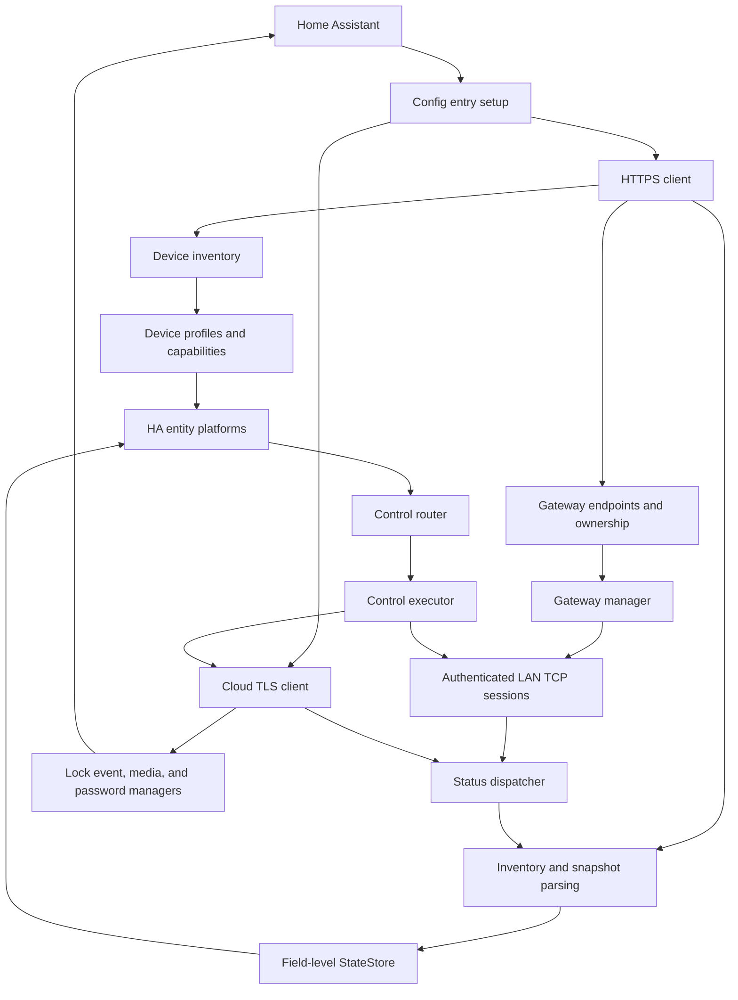

# ORVIBO Smart Control Runtime Architecture

This document describes the structure, data flow, and architecture decisions currently implemented in `orvibo-smart-control`. Behavior is defined by the code in `custom_components/orvibo_smart_control/` and its automated tests.

## System boundaries

The project interacts with three external systems:

| Boundary | Purpose | Can it work independently? |
| --- | --- | --- |
| Home Assistant | Config entries, entities, services, events, media, and lifecycle | Integration host |
| MixPad LAN gateway | Low-latency control and live pushes for supported devices | Covers only LAN devices in the capability table |
| ORVIBO cloud service | Login, region/family/device inventory, TLS live channel, and lock features | Required for initial discovery in every mode; runtime use depends on mode |

“LAN preferred” means runtime actions prefer the local channel; it does not mean installation and device discovery are fully offline. Without cloud inventory, the integration cannot reliably establish ownership relationships among accounts, families, gateways, and devices.

Repository, integration domain, service domain, media directory, card names, and entity unique-ID prefix form this project's independent identity:

```text
repository   maycode0-0/orvibo-smart-control
HA domain    orvibo_smart_control
entry class  OrviboSmartControlConfigFlow
coordinator  OrviboSmartControlCoordinator
```

## Runtime topology



### Module ownership

| Module | Main responsibility | Responsibilities it should not take on |
| --- | --- | --- |
| `https_client.py`, `protocol.py` | Cloud login, readtable, raw-record normalization | Choosing LAN/cloud control path |
| `device_types.py` | Identifying device category and verification status from composite protocol fields | Network I/O |
| `device_selection.py` | Dynamically grouping config-flow devices by actual name/type and merging selections | Changing device capabilities |
| `capabilities.py` | Platforms, read-only/cloud-only flags, and control channels by category | Building device-specific commands |
| `device_inventory.py` | Device filtering, initialization, and periodic cloud-snapshot merging | Managing live connections |
| `lan/` | Gateway discovery, authentication, TCP lifecycle, request correlation, and payload adapter | HA entity semantics |
| `ssl_client.py` | Cloud binary TLS session, pushes, and commands | LAN reachability checks |
| `status_dispatcher.py`, `parsers/` | ID matching and category-specific state patches | Keeping network connections alive |
| `state_store.py` | Field-level source revision, protection window, and deduplication | Inferring protocol fields |
| `control_router.py` | Translating HA actions into normalized methods and arguments | Choosing a transport instance |
| `control_executor.py` | Selecting channel, execution, one fallback, and optimistic state | Device classification rules |
| `lock_manager.py` | Normalizing/deduplicating lock events and correlating unlocks/openings | Downloading media |
| `lock_media_manager.py` | Signed URLs, snapshots, recordings, history, and cleanup | Classifying lock state |
| `temp_password_manager.py` | Creating, revoking, listing, and reclaiming authorizations | Exposing persistent password entities |
| `coordinator.py` | Composing the components and connecting them to the HA lifecycle | Reimplementing submodule rules |

## Config-entry lifecycle

A config entry belongs to one account region and one family. Startup follows these dependencies:

1. Read the account digest, region, family, device filters, lock-user mappings, transport mode, and general options from the config entry.
2. The HTTPS client restores the session and fetches the device inventory and gateway information.
3. `protocol.py` normalizes device records; `device_types.py` classifies them and adds them to the inventory.
4. `auto` and `cloud_only` establish a cloud TLS live channel; `lan_only` skips it.
5. `auto` and `lan_only` initialize `GatewayManager`; `cloud_only` does not discover or connect to MixPad.
6. Control and pushes are enabled only after the gateway handshake confirms session credentials and the expected UID.
7. Platforms create entities by device category, and the initial snapshot is written to the state store.
8. Start cloud-snapshot polling, online/offline notifications, update checks, authorization cleanup, and media cleanup according to options.
9. On unload, cancel timers and media tasks, close LAN/SSL connections, then unload platforms.

Runtime differences among transport modes:

| Mode | Cloud TLS | MixPad LAN | Periodic cloud snapshots | Control failure behavior |
| --- | --- | --- | --- | --- |
| `auto` (default) | Enabled | Enabled | Enabled | Use cloud if LAN is unavailable or fails |
| `lan_only` | Disabled | Enabled | Disabled | No cloud fallback; devices without LAN support cannot be controlled |
| `cloud_only` | Enabled | Disabled | Enabled | Use cloud directly |

All three modes first log in over HTTPS and discover family, devices, and trusted gateway topology during startup/reload. Thus `lan_only` is not a fully offline mode that avoids a cloud account. Optional separate LAN credentials are passed only to `GatewayManager`; when disabled, the cloud-account digest is used again. The options flow also manages device selection, account updates, cloud-name sync, local media cleanup, cloud polling from 5 to 1440 minutes, device online/offline notifications, and update checks from 6 to 168 hours. Changes to mode or general options reload the config entry so stale connections, state sources, and scheduled tasks do not remain active.

## Device classification and capabilities

A device cannot be classified by a single number alone. Runtime classification first uses the complete record fields: `deviceType`, `subDeviceType`, `classId`, `statusType`, `ui.model`, and the official catalog model. Processing order:

```text
raw cloud record
  -> normalized device fields
  -> DeviceProfile(category, verified, hidden, registration_only)
  -> DeviceCapability(platforms, channels, status_only, cloud_only)
  -> platform registration and transport policy
```

Key capability-table sets:

| Policy | Current values |
| --- | --- |
| LAN-controllable types | `0, 1, 34, 35, 36, 38, 81, 102, 501, 502, 503, 516` |
| Cloud-only types | `52, 107, 522` |
| Type-level read-only | `107` |
| Category-level read-only | Motion, temperature/humidity, door/window, smoke, emergency button, water leak, gas, lock |

`300` must be classified using its subtype: `481` is controllable floor heating, and `491` is a read-only temperature/humidity sensor, so `300` is not in the type-level cloud-only set. Unknown or unverified categories use `registration_only`: they can be registered but get no control channel.

See the [Device Support Matrix](docs/DEVICE_SUPPORT.md) for the complete inventory.

## Control selection

`control_router.py` first translates an entity action into a transport-independent normalized call, such as power, brightness, curtain position, air-conditioner temperature, or fan speed. `ControlExecutor` then selects an owner for the specific device:

```python
if mode == CLOUD_ONLY:
    return cloud_ssl_client
if LAN in capability_for(device).channels and gateway_connected(device.uid):
    result = await lan_adapter.execute(action)
    if result.ok or mode == LAN_ONLY:
        return result
if mode == LAN_ONLY:
    return failed_without_cloud_fallback
return await cloud_ssl_client.execute(action)
```

The LAN adapter reuses the cloud call's method signature, then translates it to a gateway payload. Switch polarity, brightness range, curtain position, and HVAC enums are maintained once in the normalized layer.

### Single fallback

After choosing LAN, if a call raises an exception or explicitly fails, the executor retrieves the current SSL client and retries the same normalized method once. Rules:

- No LAN adapter, gateway not ready, or device has no LAN channel: use cloud directly; this is not a fallback.
- LAN succeeds: do not send a cloud command.
- LAN fails: in `auto`, retry through cloud once; never loop between the two channels.
- In `lan_only`, an unsupported device, unreachable gateway, or failed LAN action returns failure without using SSL.
- If cloud also fails or is disconnected, return failure to the entity.
- `cloud_only` mode and cloud-only devices in `auto` never try LAN.
- Each call records its actual scope locally; concurrent devices do not share a “last channel” value.

Serials, pending requests, and response correlation are isolated between LAN and SSL. An acknowledgement confirms that a command was received; the device's final state still comes from a live push or a later snapshot written to `StateStore`.

## State normalization and merging

LAN and cloud live packets are first matched to a device ID/UID by `status_dispatcher.py`, then passed through the same `parsers/` modules to create minimal field patches. Parsers update only fields explicitly present in a packet; partial pushes do not clear other attributes.

Light initialization and periodic cloud snapshots also use the light parser, which preserves percentage or 0–255 brightness units by device type. Negative, non-numeric, and non-finite brightness is treated as unknown and does not overwrite the most recent valid level or imply that the light is off. Brightness is unknown at first if there is no valid reading. A valid zero brightness is parsed according to that device's protocol; entity output and control paths validate numeric values separately.

`StateSource` values:

| Source | Value | Typical data |
| --- | ---: | --- |
| `INITIAL` | 0 | Entity initial value |
| `OPTIMISTIC` | 10 | Estimate after control succeeds but before real state arrives |
| `CLOUD` | 20 | REST/readtable snapshot |
| `SSL` | 30 | Cloud TLS live push |
| `LAN` | 40 | Gateway live push |

The state store records source and monotonic time for each `(device_id, field)`. During the default 30-second protection window, a lower-priority patch cannot overwrite a higher-priority field. Outside the window, a newer low-priority snapshot may correct a higher-priority value that has been disconnected for a long time. Priority is therefore “freshness protection,” not permanent source ownership.

When a field's value does not change, it is not added to the changed set, but its revision time and source still update. Optimistic updates keep the UI responsive; any later real source can overwrite them. Device removal must also remove its field revisions.

`get_device_state()` reads state without modifying `online`. Device live pushes report state changes and are not fixed-period heartbeats for every device, so a device must not be marked offline only because it has not pushed for 10 minutes. Availability follows the merged result of snapshots and live reports: an explicit offline cloud snapshot can still mark a device unavailable; when no new report arrives, the most recent known state is retained. An optimistic control update does not mean the device came back online.

`cloud_only` mode rejects all LAN state. `auto` and `lan_only` also reject LAN pushes for cloud-only devices to prevent same-name or incorrect-topology devices from polluting lock/dryer state. `lan_only` still uses the initial cloud snapshot from startup discovery, but after startup, live changes and control come only from LAN; no cloud live channel is established and snapshots are not polled periodically.

## LAN session model

Each gateway connection has one reader task and distributes responses by a reliable correlation key. Requests without a reliable key are serialized by a lock so only one remains pending.
Connection setup includes hello, session key, login, and UID validation; every step has a timeout.

Connection generations isolate readers, writers, and pending futures before and after reconnect. When closing a session, the current generation is invalidated before cancelling tasks, completing pending requests, and closing the writer. This prevents an old reader from parsing new-session data. Heartbeats detect half-open connections; only an authenticated connection marked `_ready` reports `connected=True`.

Logs use masked hosts and identifiers. Non-zero status, identity conflicts, malformed frames, and timeouts are treated as failures, then the gateway manager reconnects or the control layer falls back to cloud.

## Cloud protocol model

The HTTPS channel handles region discovery, login, family/device snapshots, and door-lock REST data. The TLS long connection handles live pushes, ordinary cloud control, lock commands, and response correlation. The project has no standalone MQTT client; calling the `cmd=42` status push “MQTT” in old code is historical terminology. The protocol actually runs over the vendor's binary TLS session.

If the TLS reader exits unexpectedly, the client clears the connection flag and releases pending requests immediately, then establishes a new session. Temporary disconnect cleanup is separate from integration unload: temporary cleanup allows retries to continue, while unload stops recovery. A missing reader does not block reconnection.
Cloud send waits are limited to 10 seconds. A missing writer, write failure, or send timeout raises an exception to the caller; a network failure also closes the failed stream, allowing the listener loop to recover. Commands with an unknown send result are not replayed automatically and do not write a successful optimistic state. If sending completes normally but no state acknowledgement arrives, the existing optimistic-state policy remains.

The shared client certificate is public protocol material needed to connect to the vendor service. Account digests, tokens, session keys, and temporary media credentials are the secrets each installation must protect. See the [Security Policy](SECURITY.md) for trust boundaries.

## Door-lock subsystem

Lock state, events, media, and authorizations all use the cloud:

1. `status_dispatcher` marks door-lock live packets with `source=ssl`.
2. `LockEventManager` normalizes bolt, door contact, unlock method, and user number, then deduplicates events.
3. The coordinator adds the public `source` field and publishes `orvibo_smart_control_lock_event`.
4. `LockMediaManager` creates short-lived signed URLs for event object keys, asynchronously updates camera snapshots, and archives recordings.
5. `TempPasswordManager` creates/revokes authorizations through cloud commands and queries server records through readtable.

Media service responses use an allowlist and do not return host absolute paths. Authorization lists and events do not include passwords; a new password appears only in the current response from its creation service. Recordings are retained for 7 days by default and cleaned weekly. Snapshots are retained by configured count per device (30 by default, range 1–500) and are not removed by automatic recording cleanup. Temporary authorizations are checked every 6 hours.

## Home Assistant surface

The integration exposes eight platforms, eight services, two public events, and a built-in card. Services are registered once when the domain initializes; the target config entry is determined by optional `entry_id` and device ownership. Door-lock services with responses declare `SupportsResponse.OPTIONAL`.
`runtime_options.py` handles optional device online/offline notifications and GitHub stable-release checks; both are disabled by default. Notifications are sent only when a known online state genuinely changes, not during initialization.

For every selected device with an entity platform, the Sensor platform creates an enum diagnostic entity `transport_path`. Its state is calculated by `transport_path_for()` from device capabilities and config mode, not inferred from a name. Attributes expose LAN/cloud control capability, gateway connection, and most recent successful control channel during the current run. `ControlExecutor` records the last channel only after success; if LAN fails but cloud succeeds as fallback, it records `cloud`. It is empty after restart.

Entity `unique_id`, device association, and service domain all use `orvibo_smart_control` as prefix or owner and do not share identity with the source integration. See [Services and Events Reference](docs/SERVICES_AND_EVENTS.md) for the user-facing API.

## Failure and consistency boundaries

| Failure | Current behavior | Not guaranteed |
| --- | --- | --- |
| Gateway discovery fails | `auto` retains cloud capability; `lan_only` reports local unavailable | Pure LAN will not bypass mode and fall back to cloud |
| LAN request times out / non-zero status | `auto` retries through cloud once; `lan_only` fails directly | No unlimited retry or cross-channel acknowledgement matching |
| Cloud live connection drops | Reconnects; REST snapshots can still correct state | Cloud-only live updates while disconnected |
| REST fetch fails | Retains existing inventory and state | New devices appear immediately |
| Partial push | Merges only fields present in packet | Inferring state from missing fields |
| Unknown device | Registers for display; sends no controls | Automatically controlling it based on a similar model |
| ffmpeg missing | Keeps original H.264 file | MP4 is guaranteed playable |

## Architecture Decision Records

| ADR | Decision | Status | Consequence |
| --- | --- | --- | --- |
| 001 | Use a separate repository and `orvibo_smart_control` domain | Accepted | No implicit cross-project config migration |
| 002 | Provide `auto`, `lan_only`, and `cloud_only`; default to `auto` | Accepted | Keep cloud-only devices available by default while allowing users to restrict to one channel |
| 003 | Explicitly declare LAN/SSL channels in device capabilities | Accepted | Routing does not guess device type from errors |
| 004 | Share a normalized control API between transport adapters | Accepted | One source of device semantics |
| 005 | Retry through cloud at most once after LAN failure | Accepted | Predictable delay and no repeated action loop |
| 006 | Merge state by field with 30-second priority protection | Accepted | Fresh LAN state is not immediately rolled back by an old cloud snapshot |
| 007 | Use cloud-only policy for `52/107/522` | Accepted | Keep Wi-Fi direct-control and lock features available |
| 008 | Do not assign a control channel to unverified devices | Accepted | Safety takes precedence over speculative compatibility |
| 009 | Fully isolate LAN/SSL request correlation | Accepted | Concurrent calls and fallbacks cannot consume acknowledgements from the other channel |
| 010 | Do not expose host paths or stored passwords in public service responses | Accepted | Reduce exposure through Recorder, logs, and automations |

## Test mapping

| Focus | Main tests |
| --- | --- |
| Capabilities and cloud-only policy | `test_capabilities.py`, `test_device_profiles.py` |
| Channel selection and fallback | `test_control_transport.py`, `test_control_executor.py` |
| Mode initialization and separate LAN credentials | `test_coordinator_transport.py`, `test_config_flow_reauth.py` |
| Transport indicator and latest actual channel | `test_transport_sensor.py`, `test_capabilities.py`, `test_control_transport.py` |
| LAN frames, connection, and adapter | `test_lan_packet.py`, `test_lan_gateway_connection.py`, `test_lan_control_adapter.py` |
| State priority | `test_state_store.py`, `test_status_dispatcher.py` |
| Device parsing and control semantics | `test_state_parsers.py`, `test_control_router.py`, device-specific tests |
| Locks, media, and authorization | `test_lock_manager.py`, `test_lock_media_manager.py`, `test_temp_password_manager.py` |
| Public service safety | `test_service_handlers.py`, `test_video_archive.py` |

Tests for new cross-module behavior must cover the normal path, timeout/exception, fallback count, source marker, and sensitive-field boundaries.

## Known limitations

- Device discovery still depends on an ORVIBO account and cloud inventory; this is not a fully offline LAN integration.
- `lan_only` cannot update or control cloud-only/Wi-Fi-direct devices such as locks and clothes dryers.
- Only types listed in the capability table get LAN control; new models of the same type still need real-device validation.
- The private live-video protocol for door-view cameras has not been implemented; camera entities display event snapshots.
- Vendor protocols and APIs have no stable public specification; firmware or server changes may require new packet-capture analysis.
- The state-protection window handles short-term out-of-order data; it does not replace device clocks or a distributed-consistency protocol.
